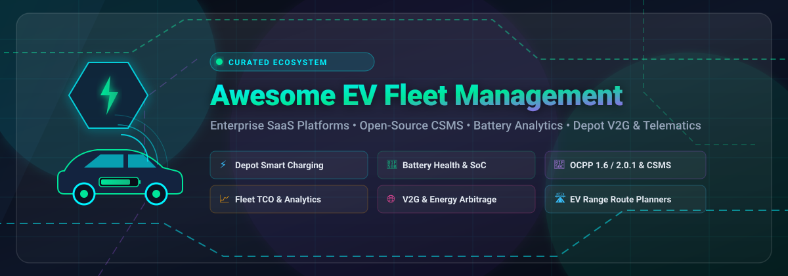

<p align="center">
  
</p>

# ⚡ Awesome EV Fleet Management 🚗🔋

<p align="center">
  <a href="https://github.com/ishandutta2007/Awesome-Awesome-Awesome"></a>
  <a href="https://discord.gg/jc4xtF58Ve"></a>
  <a href="https://github.com/ishandutta2007/Awesome-EV-Fleet-Management/stargazers"></a>
  <a href="https://github.com/ishandutta2007/Awesome-EV-Fleet-Management/network/members"></a>
  <a href="https://github.com/ishandutta2007/Awesome-EV-Fleet-Management/issues"></a>
  <a href="https://github.com/ishandutta2007/Awesome-EV-Fleet-Management/blob/main/LICENSE"></a>
  <a href="https://github.com/ishandutta2007"></a>
</p>

> 🚀 **Curated Directory of Top Commercial SaaS Platforms & Open-Source Projects for Electric Vehicle (EV) Fleet Management, Depot Charging Optimization, Battery Health Analytics, OCPP CSMS, and Smart Grid V2G Integration.**

---

## 📌 Overview & SEO Highlights

Managing an electric fleet requires specialized tools that go far beyond conventional GPS tracking and ICE fleet management. **EV Fleet Management** requires real-time coordination of:
- 🔌 **Depot Smart Charging & OCPP CSMS**: Dynamic load balancing, peak shaving, and charger management via OCPP 1.6-J & OCPP 2.0.1.
- 🔋 **Battery Health & Telematics (SoC / SoH)**: Deep CAN-bus telemetry, State-of-Charge monitoring, State-of-Health degradation modeling, and range prediction.
- ⚡ **Energy Management & V2G Arbitrage**: Time-of-Use (ToU) electricity rate optimization, solar PV self-consumption, and Vehicle-to-Grid (V2G) grid service dispatch.
- 🛣️ **EV Route Planning & Range Optimization**: Elevation-aware route optimization, charging stop planning, and mixed-fleet dispatch constraints.
- 📈 **Electrification Feasibility & TCO Analytics**: Total Cost of Ownership simulation, transition planning, and carbon reduction reporting.

---

## 📑 Table of Contents

- [🏢 SaaS & Hosted Platforms](#-saashosted-platforms)
- [💻 Open-Source GitHub Projects](#-open-source-github-projects)
- [🏗️ Architecture Patterns for Custom EV Systems](#️-architecture-patterns-for-custom-ev-systems)
- [🤝 How to Contribute](#-how-to-contribute)
- [🌟 Star History](#-star-history)
- [⚠️ Disclaimer](#️-disclaimer)

---

## 🏢 SaaS/Hosted Platforms

The following enterprise platforms are sorted in **descending order of company size** (market capitalization / valuation / annual revenue):

| 🏢 Platform | 📝 Description | 💰 Pricing (Starting Tier) | 🎁 Free Tier / Trial Limits | 📊 Company Size / Valuation |
| :--- | :--- | :--- | :--- | :--- |
| **[Hitachi ZeroCarbon](https://www.hitachi.com/)** | 🌐 Enterprise solutions for zero-carbon mobility and fleet electrification, combining BatteryManager analytics, depot charging, and TCO financing. | Custom managed service packages starting from ~$50/vehicle/month (or financed per-kWh/charger infrastructure models) | No free-forever plan; Free access to HGV Carbon & Cost Calculator and fleet readiness assessment | **~$96.5B+ Annual Revenue** (TYO: 6501 / ~$100B+ Market Cap) |
| **[Samsara Fleet Electrification](https://www.samsara.com/)** | 🚛 Unified fleet IoT platform offering EV suitability scoring, charging analytics, battery insights, and mixed-fleet visibility for organizations transitioning to electric. | Starts at ~$27 – $33/vehicle/month (telematics tier; hardware ~$99–$148 upfront; 3-year contract) | 30-day free trial (includes test hardware units with full platform access; return before 30 days to avoid charges) | **~$22.8B Market Cap** / ~$1.99B ARR (NYSE: IOT) |
| **[Geotab EV](https://www.geotab.com/)** | 📡 Telematics platform with deep EV data support (300+ models), battery state-of-charge/health monitoring, suitability analysis, and electrification planning tools. | Starts at ~$30 – $40/vehicle/month (GO Core / GO tier via authorized resellers) | No free-forever plan; 30-day free pilot program (e.g. Geotab Vitality) with GO tracker hardware | **~$1B+ Annual Revenue (ARR)** / ~$6B–$8B Est. Valuation (Private) |
| **[Driivz Fleet / InSite](https://driivz.com/)** | ⚡ Comprehensive EV charging management system (CSMS) supporting depot operations, smart energy optimization, and driver billing. | Starts at ~$600 – $800/port/year (~$50 – $67/port/month for cloud management) | No free-forever plan; Free interactive demo and custom ROI calculation consultation | **Acquired by Vontier Corp** (NYSE: VNT, ~$5B Market Cap, ~$200M+ acquisition) |
| **[ChargePoint Fleet](https://www.chargepoint.com/)** | 🔌 Fleet-focused charging software and hardware ecosystem for managing depot and workplace charging sessions, energy use, and driver policies. | Starts at ~$360 – $1,630/port/year (~$30 – $135/port/month depending on Core vs. Enterprise Fleet tier) | No free-forever plan; Free site assessment & custom fleet pilot upon consultation | **~$160M Market Cap** / ~$400M+ Annual Revenue (NYSE: CHPT) |
| **[AMPECO Fleet](https://www.ampeco.com/)** | 🔄 Hardware-agnostic EV charging network management platform (CPMS) with fleet-oriented charging controls, dynamic tariffs, and roaming. | Starts at ~$10 – $25/charging point/month (plus initial onboarding & setup fee) | No free-forever plan; Live interactive demo & sandbox environment upon sales inquiry | **~$100M+ Est. Valuation** ($39M Total VC Funding raised) |
| **[Ampcontrol](https://www.ampcontrol.io/)** | 🤖 AI-driven EV charging and energy management platform specialized in depot charging optimization, load management, and OCPP-compliant charger integration. | Starts at ~$2,000/month for depot energy management & CSMS cloud platform | No free-forever plan; Guided demo & tailored pilot evaluation available upon request | **~$40M–$60M Est. Valuation** ($10.1M VC Funding raised) |
| **[Optiwatt Fleet](https://www.optiwatt.com/)** | 💡 Smart charging and energy management platform aimed at optimizing EV charging costs and utility grid interaction for fleets and drivers. | **Free** for standard vehicle tracking & automated charge scheduling (utility-funded model) | Free forever for unlimited vehicles and automated charging schedule optimization | **~$25M–$40M Est. Valuation** (~$10M Series A Funding) |
| **[Volteras](https://www.volteras.com/)** | 🔗 Unified OEM connected-vehicle API and EV fleet charging platform for direct vehicle telematics and energy optimization without aftermarket hardware. | Starts at ~$2 – $5/connected vehicle/month for direct OEM API data access | Free developer sandbox tier with unlimited test calls for simulated/mock vehicle VINs | **~$15M–$25M Est. Valuation** (~$5M+ Seed/Series A Funding) |
| **[EVenergi (BetterFleet)](https://www.evenergi.com/)** | 📊 Electrification planning, digital twin depot modeling, and fleet transition simulation platform for public transit and commercial fleets. | Starts at ~$15 – $30/vehicle/month for digital twin modeling & transition planning tools | No free-forever plan; Free demo and preliminary electrification feasibility assessment | **~$10M–$15M Est. Valuation** (ARENA Grant & VC Backed) |

---

## 💻 Open-Source GitHub Projects

The following curated open-source repositories provide foundational building blocks for EV telematics, OCPP charging protocols, battery modeling, and energy optimization. Repositories are sorted in **descending order of GitHub Star count**:

- **[TeslaMate](https://github.com/teslamate-org/teslamate)** [](https://github.com/teslamate-org/teslamate/stargazers)  
  🚗 Self-hosted data logger and analytics platform for Tesla vehicles and fleets, capturing charging efficiency, vampire drain, battery degradation, and trip telemetry via MQTT and Grafana.

- **[Traccar](https://github.com/traccar/traccar)** [](https://github.com/traccar/traccar/stargazers)  
  📡 Leading open-source GPS tracking and fleet telematics platform supporting over 200 communication protocols, geofencing, fuel/battery telemetry, and customizable notification hooks.

- **[evcc](https://github.com/evcc-io/evcc)** [](https://github.com/evcc-io/evcc/stargazers)  
  ☀️ Popular open-source solar-aware EV charging controller that dynamically optimizes charging based on PV generation, home battery storage, dynamic electricity spot prices, and vehicle SoC.

- **[PyBaMM](https://github.com/pybamm-team/PyBaMM)** [](https://github.com/pybamm-team/PyBaMM/stargazers)  
  🔬 Open-source Python battery mathematical modeling library solving continuum physics-based models (DFN, SPM, SPMe) for EV battery degradation, thermal modeling, and State-of-Health prediction.

- **[OpenEMS](https://github.com/OpenEMS/openems)** [](https://github.com/OpenEMS/openems/stargazers)  
  ⚡ Modular energy management system (EMS) for controlling energy storage, solar PV arrays, and EV charging stations with peak shaving and grid stabilization algorithms.

- **[Steve](https://github.com/steve-community/steve)** [](https://github.com/steve-community/steve/stargazers)  
  🔌 Mature open-source Charging Station Management System (CSMS) implementing the OCPP protocol (OCPP 1.2, 1.5, 1.6-J) for managing station sessions, user RFID authentication, and charging logs.

- **[mobilityhouse/ocpp](https://github.com/mobilityhouse/ocpp)** [](https://github.com/mobilityhouse/ocpp/stargazers)  
  🐍 Widely adopted Python implementation of the Open Charge Point Protocol (OCPP 1.6 and OCPP 2.0.1) for building custom CSMS backends and charging station emulators.

- **[ocpp-go](https://github.com/lorenzodonini/ocpp-go)** [](https://github.com/lorenzodonini/ocpp-go/stargazers)  
  🐹 High-performance Go implementation of OCPP 1.6 and 2.0.1 (JSON & SOAP) with built-in client and central system support for high-throughput charging hubs.

- **[CitrineOS Core](https://github.com/citrineos/citrineos-core)** [](https://github.com/citrineos/citrineos-core/stargazers)  
  🌐 Modern, microservice-based open-source CSMS written in TypeScript supporting OCPP 2.0.1, dynamic charging profiles, certificate management, and modular fleet extensions.

- **[EVerest](https://github.com/EVerest/EVerest)** [](https://github.com/EVerest/EVerest/stargazers)  
  🛠️ Linux Foundation open-source software stack for EV charging infrastructure, connecting chargers, local energy managers, and cloud backends via ISO 15118, DIN 70121, and OCPP.

- **[FlexMeasures](https://github.com/FlexMeasures/flexmeasures)** [](https://github.com/FlexMeasures/flexmeasures/stargazers)  
  ⏱️ Intelligent energy flexibility service and optimization engine that schedules EV charging and V2G operations according to dynamic day-ahead market prices and grid constraints.

- **[OpenSTEF](https://github.com/OpenSTEF/openstef)** [](https://github.com/OpenSTEF/openstef/stargazers)  
  📈 Open Short-Term Energy Forecasting platform using machine learning to predict electrical load profiles and renewable generation for EV charging depots and grid operators.

- **[FleetRL](https://github.com/EnzoCording/FleetRL)** [](https://github.com/EnzoCording/FleetRL/stargazers)  
  🧠 Reinforcement-learning OpenAI Gym environment specifically tailored for optimizing smart EV fleet charging schedules with spot electricity pricing and solar generation.

- **[EVtivity CSMS](https://github.com/EVtivity/evtivity-csms)** [](https://github.com/EVtivity/evtivity-csms/stargazers)  
  🚌 Self-hosted Charging Station Management System (OCPP 1.6 and 2.1, 2.0.1 compatible) for depot charging: departure-aware planning that has each fleet vehicle ready by its departure within the site power limits, a VDV 463 interface for bus depot systems, fleet billing with invoices, and load management across transformers, panels, circuits, batteries and solar. Source-available under the Business Source License 1.1, free for a single operator's own network.

- **[OpenCPO](https://github.com/opencpo/opencpo)** [](https://github.com/opencpo/opencpo/stargazers)  
  🔋 Open-source EV charging platform with OCPP 1.6/2.0.1 central system, administrator dashboard, driver mobile interface, and simulated hardware test harness.

---

## 🏗️ Architecture Patterns for Custom EV Systems

```
               ┌────────────────────────────────────────────────────────┐
               │              Fleet Telematics Layer                    │
               │   (OEM APIs / CAN-bus / Traccar / TeslaMate / MQTT)    │
               └──────────────────────────┬─────────────────────────────┘
                                          │ Vehicle SoC & Telemetry
                                          ▼
┌─────────────────────────┐    ┌────────────────────────────────────────┐    ┌─────────────────────────┐
│     Energy Tariffs      │───►│       Optimization Engine              │◄───│   Solar PV / Battery    │
│  (Spot Price / ToU APIs)│    │   (FleetRL / FlexMeasures / MILP)      │    │      (OpenEMS)          │
└─────────────────────────┘    └──────────────────┬─────────────────────┘    └─────────────────────────┘
                                                  │ Smart Charging Schedules
                                                  ▼
                               ┌────────────────────────────────────────┐
                               │           OCPP CSMS Gateway            │
                               │  (CitrineOS / Steve / mobilityhouse)   │
                               └──────────────────┬─────────────────────┘
                                                  │ OCPP 1.6-J / 2.0.1
                                                  ▼
                               ┌────────────────────────────────────────┐
                               │       EV Chargers & Depot Hubs         │
                               └────────────────────────────────────────┘
```

- **Telematics & Data Ingestion**: Pull live State of Charge (SoC), location, and odometer readings via direct OEM APIs (Volteras, Smartcar) or hardware devices into MQTT + InfluxDB + Grafana dashboards.
- **Smart Charging Optimization**: Feed electricity spot market tariffs, solar PV production forecasts, and vehicle departure schedules into optimization engines (**FleetRL**, **FlexMeasures**) to generate cost-optimal charging schedules.
- **OCPP CSMS Execution**: Dispatch charging setpoints and profiles (OCPP `SetChargingProfile`) via open CSMS backends (**CitrineOS**, **Steve**, or **mobilityhouse/ocpp**) down to depot chargers.

---

## 🤝 How to Contribute

1. 🍴 Fork this repository.
2. ✏️ Add or update entries in `README.md` (keep descriptions factual, concise, and linked to official resources).
3. 🏷️ Ensure new SaaS tools include pricing, free tier/trial limits, and company size columns; open-source entries should include the shields social star badge.
4. 🚀 Submit a Pull Request (PR) with a brief summary of changes.

---

## 🌟 Star History

[](https://star-history.dera.page/#ishandutta2007/Awesome-EV-Fleet-Management&type=date&legend=top-left)

---

## ⚠️ Disclaimer

- This is an **open community-curated list** for informational and educational purposes — not an official endorsement.
- EV fleet management and high-power DC/AC depot charging involve safety-critical operations, grid capacity limits, and battery warranty constraints. Always validate charging strategies against OEM specifications and local electrical codes.

---

<p align="center">
  <b>⚡ Accelerating the transition to zero-emission electric mobility with open data, smart charging, and optimized fleets. 🌿</b>
</p>
